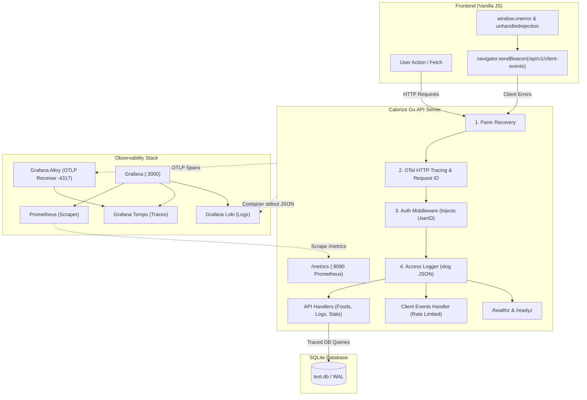

# Observability & Reporting Implementation Plan

> **For agentic workers:** REQUIRED SUB-SKILL: Use superpowers:subagent-driven-development to implement this plan task-by-task. Steps use checkbox (`- [ ]`) syntax for tracking.

**Goal:** Implement end-to-end observability, error fidelity, Prometheus metrics, OpenTelemetry distributed tracing, and client-side error reporting in Calorize, mirroring the production-grade architecture from `off-kolor-api`.

**Architecture:** An OpenTelemetry and Prometheus telemetry pipeline embedded into the Go HTTP server and SQLite database layer, combined with a sanitized client error beacon and a full Grafana/Alloy/Tempo/Loki observability stack. Every request carries an `X-Request-Id` and `trace_id` propagated through Go's `context.Context` to `slog` access logs and Tempo traces.

**Architecture Diagram:**



**Tech Stack:**
- Go 1.25+ (`net/http`, `log/slog`, `database/sql`)
- OpenTelemetry Go SDK (`go.opentelemetry.io/otel`, `otelhttp`)
- Prometheus Go Client (`github.com/prometheus/client_golang`)
- Vanilla JavaScript (`window.onerror`, `navigator.sendBeacon`)
- Docker Compose, Grafana Alloy, Grafana Tempo, Prometheus, Grafana Loki

## Global Constraints
- Standard library `net/http` routing (Go 1.22+ patterns).
- No external JS frameworks or frontend build step.
- Database access remains SQLite via `database/sql`.
- Strictly no secrets, tokens, or PII logged in server logs or client event payloads.
- All primary keys remain UUIDs (`github.com/google/uuid`).

---

### Task 1: Docker Build Git SHA & Log Rotation

**Files:**
- Modify: `docker/Dockerfile.api`
- Modify: `docker/Dockerfile.web`
- Modify: `docker/docker-compose.yml`
- Modify: `cmd/api-server/main.go`

**Interfaces:**
- Produces: `main.GitSHA` variable populated via `-ldflags` during Docker build, echoed in server startup log and `X-Calorize-Build` header.

- [ ] **Step 1: Update `cmd/api-server/main.go` with `GitSHA` global variable**

Add `var GitSHA = "dev"` to `cmd/api-server/main.go` and log it on startup:
```go
var GitSHA = "dev"
```
In `main()`:
```go
logger.InfoContext(ctx, "Starting API server...", "build", GitSHA)
```

- [ ] **Step 2: Update `docker/Dockerfile.api` to accept `GIT_SHA` build arg and pass `-ldflags`**

Modify `docker/Dockerfile.api`:
```dockerfile
ARG GIT_SHA=dev
RUN CGO_ENABLED=0 go build -ldflags="-X 'main.GitSHA=${GIT_SHA}'" -o /app/api-server ./cmd/api-server
```

- [ ] **Step 3: Update `docker/Dockerfile.web` to embed `GIT_SHA` into index or version file**

Modify `docker/Dockerfile.web`:
```dockerfile
ARG GIT_SHA=dev
RUN echo "{\"build\":\"${GIT_SHA}\"}" > /usr/share/nginx/html/version.json
```

- [ ] **Step 4: Update `docker/docker-compose.yml` with build args and JSON log rotation**

Add `args: [GIT_SHA=${GIT_SHA:-dev}]` and logging limits:
```yaml
logging:
  driver: "json-file"
  options:
    max-size: "20m"
    max-file: "5"
```

- [ ] **Step 5: Verify build with Git SHA**

Run: `go build -ldflags="-X 'main.GitSHA=test-sha'" ./cmd/api-server && ./api-server --help || true`
Expected: Server binary builds successfully with GitSHA compiled in.

- [ ] **Step 6: Commit**

```bash
git add docker/ cmd/api-server/main.go
git commit -m "feat(obs): phase 0 docker build git sha and log rotation"
```

---

### Task 2: Sentinel Database Errors & `/readyz` Probe

**Files:**
- Create: `internal/db/errors.go`
- Modify: `internal/db/database.go`
- Create: `internal/api/probes.go`
- Test: `internal/api/probes_test.go`
- Modify: `cmd/api-server/main.go`

**Interfaces:**
- Produces: `db.ErrNotFound`, `db.ErrConflict`, `db.ErrInvalidInput`, `db.Ping(ctx)`
- Produces: `GET /readyz` HTTP endpoint returning 200 OK or 503 Service Unavailable

- [ ] **Step 1: Write failing test for `/readyz` and `/healthz` probes**

Create `internal/api/probes_test.go`:
```go
package api_test

import (
	"net/http"
	"net/http/httptest"
	"testing"

	"azule.info/calorize/internal/api"
)

func TestProbes(t *testing.T) {
	mux := http.NewServeMux()
	api.RegisterProbePaths(mux)

	// Test /healthz
	req := httptest.NewRequest("GET", "/healthz", nil)
	rr := httptest.NewRecorder()
	mux.ServeHTTP(rr, req)
	if rr.Code != http.StatusOK {
		t.Fatalf("expected /healthz 200, got %d", rr.Code)
	}

	// Test /readyz
	reqReady := httptest.NewRequest("GET", "/readyz", nil)
	rrReady := httptest.NewRecorder()
	mux.ServeHTTP(rrReady, reqReady)
	if rrReady.Code != http.StatusOK && rrReady.Code != http.StatusServiceUnavailable {
		t.Fatalf("unexpected /readyz status: %d", rrReady.Code)
	}
}
```

- [ ] **Step 2: Run test to verify it fails**

Run: `go test ./internal/api/ -run TestProbes`
Expected: FAIL compilation ("undefined: api.RegisterProbePaths")

- [ ] **Step 3: Define sentinel domain errors in `internal/db/errors.go`**

Create `internal/db/errors.go`:
```go
package db

import "errors"

var (
	ErrNotFound     = errors.New("record not found")
	ErrConflict     = errors.New("resource conflict")
	ErrInvalidInput = errors.New("invalid input")
	ErrDatabase     = errors.New("database operation failed")
)
```

- [ ] **Step 4: Implement `db.PingContext` in `internal/db/database.go`**

Add to `internal/db/database.go`:
```go
func PingContext(ctx context.Context) error {
	if DB == nil {
		return errors.New("database connection is nil")
	}
	return DB.PingContext(ctx)
}
```

- [ ] **Step 5: Implement `internal/api/probes.go`**

Create `internal/api/probes.go`:
```go
package api

import (
	"context"
	"net/http"
	"time"

	"azule.info/calorize/internal/db"
)

func RegisterProbePaths(mux *http.ServeMux) {
	mux.HandleFunc("GET /healthz", HealthHandler)
	mux.HandleFunc("GET /readyz", ReadyHandler)
}

func HealthHandler(w http.ResponseWriter, r *http.Request) {
	w.Header().Set("Content-Type", "application/json")
	w.WriteHeader(http.StatusOK)
	w.Write([]byte(`{"status":"ok"}`))
}

func ReadyHandler(w http.ResponseWriter, r *http.Request) {
	ctx, cancel := context.WithTimeout(r.Context(), 2*time.Second)
	defer cancel()

	if err := db.PingContext(ctx); err != nil {
		w.Header().Set("Content-Type", "application/json")
		w.WriteHeader(http.StatusServiceUnavailable)
		w.Write([]byte(`{"status":"unavailable","error":"database unreachable"}`))
		return
	}

	w.Header().Set("Content-Type", "application/json")
	w.WriteHeader(http.StatusOK)
	w.Write([]byte(`{"status":"ready"}`))
}
```

- [ ] **Step 6: Run test to verify it passes**

Run: `go test ./internal/api/ -run TestProbes`
Expected: PASS

- [ ] **Step 7: Commit**

```bash
git add internal/db/errors.go internal/db/database.go internal/api/probes.go internal/api/probes_test.go
git commit -m "feat(obs): phase 0 sentinel errors and readyz probe"
```

---

### Task 3: Contextual Logging, Request ID & Access Middleware

**Files:**
- Create: `internal/middleware/telemetry.go`
- Modify: `internal/middleware/logging.go`
- Test: `internal/middleware/telemetry_test.go`
- Modify: `cmd/api-server/main.go`

**Interfaces:**
- Produces: `middleware.RequestTelemetry` attaching `request_id`, `trace_id`, `user_id` to `context.Context` and response headers.
- Produces: Enriched structured slog records per HTTP request.

- [ ] **Step 1: Write test for RequestTelemetry middleware**

Create `internal/middleware/telemetry_test.go`:
```go
package middleware_test

import (
	"net/http"
	"net/http/httptest"
	"testing"

	"azule.info/calorize/internal/middleware"
)

func TestRequestTelemetryEchoesRequestID(t *testing.T) {
	handler := middleware.RequestTelemetry("v1.0.0")(http.HandlerFunc(func(w http.ResponseWriter, r *http.Request) {
		w.WriteHeader(http.StatusOK)
	}))

	// Given an incoming X-Request-Id
	req := httptest.NewRequest("GET", "/test", nil)
	req.Header.Set("X-Request-Id", "custom-req-id-123")
	rr := httptest.NewRecorder()

	handler.ServeHTTP(rr, req)

	if got := rr.Header().Get("X-Request-Id"); got != "custom-req-id-123" {
		t.Fatalf("expected echoed X-Request-Id, got %s", got)
	}
	if gotBuild := rr.Header().Get("X-Calorize-Build"); gotBuild != "v1.0.0" {
		t.Fatalf("expected X-Calorize-Build v1.0.0, got %s", gotBuild)
	}
}
```

- [ ] **Step 2: Run test to verify it fails**

Run: `go test ./internal/middleware/ -run TestRequestTelemetry`
Expected: FAIL ("undefined: middleware.RequestTelemetry")

- [ ] **Step 3: Implement `internal/middleware/telemetry.go`**

Create `internal/middleware/telemetry.go`:
```go
package middleware

import (
	"context"
	"crypto/rand"
	"encoding/hex"
	"fmt"
	"net/http"
	"strings"
	"time"

	"azule.info/calorize/internal/auth"
	"github.com/google/uuid"
	"go.opentelemetry.io/otel/trace"
)

type contextKey string

const (
	RequestIDKey contextKey = "request_id"
)

func generateRequestID() string {
	u, err := uuid.NewV7()
	if err == nil {
		return u.String()
	}
	// Fallback to random hex
	b := make([]byte, 16)
	rand.Read(b)
	return hex.EncodeToString(b)
}

func RequestTelemetry(buildVersion string) func(http.Handler) http.Handler {
	return func(next http.Handler) http.Handler {
		return http.HandlerFunc(func(w http.ResponseWriter, r *http.Request) {
			reqID := r.Header.Get("X-Request-Id")
			if reqID == "" {
				reqID = generateRequestID()
			}

			w.Header().Set("X-Request-Id", reqID)
			if buildVersion != "" {
				w.Header().Set("X-Calorize-Build", buildVersion)
			}

			ctx := context.WithValue(r.Context(), RequestIDKey, reqID)
			next.ServeHTTP(w, r.WithContext(ctx))
		})
	}
}

func GetRequestID(ctx context.Context) string {
	if val := ctx.Value(RequestIDKey); val != nil {
		if s, ok := val.(string); ok {
			return s
		}
	}
	return ""
}
```

- [ ] **Step 4: Update `internal/middleware/logging.go` to extract `user_id`, `request_id`, and `trace_id`**

Update `Logger` in `internal/middleware/logging.go`:
```go
func Logger(next http.Handler) http.Handler {
	return http.HandlerFunc(func(w http.ResponseWriter, r *http.Request) {
		start := time.Now()
		rw := &responseWriter{
			ResponseWriter: w,
			status:         http.StatusOK,
		}

		next.ServeHTTP(rw, r)

		duration := time.Since(start)
		ctx := r.Context()
		reqID := GetRequestID(ctx)

		userIDStr := "anonymous"
		if v := ctx.Value(auth.UserIDContextKey); v != nil {
			userIDStr = fmt.Sprintf("%v", v)
		}

		traceIDStr := ""
		spanCtx := trace.SpanContextFromContext(ctx)
		if spanCtx.IsValid() {
			traceIDStr = spanCtx.TraceID().String()
		}

		slog.InfoContext(ctx, "http.request",
			"method", r.Method,
			"path", r.URL.Path,
			"status", rw.status,
			"duration_ms", duration.Milliseconds(),
			"bytes_written", rw.bytesWritten,
			"request_id", reqID,
			"user_id", userIDStr,
			"trace_id", traceIDStr,
			"remote_addr", r.RemoteAddr,
			"user_agent", r.UserAgent(),
		)
	})
}
```

- [ ] **Step 5: Run test to verify it passes**

Run: `go test ./internal/middleware/ -run TestRequestTelemetry`
Expected: PASS

- [ ] **Step 6: Update `cmd/api-server/main.go` middleware pipeline order**

Update `finalHandler` pipeline in `cmd/api-server/main.go` so `RequestTelemetry` runs first, wrapping `Recoverer`, `CORS`, and router.

- [ ] **Step 7: Commit**

```bash
git add internal/middleware/ cmd/api-server/main.go
git commit -m "feat(obs): phase 1 request context and access logging"
```

---

### Task 4: API Error Fidelity & `WriteError` Helper

**Files:**
- Create: `internal/api/errors.go`
- Test: `internal/api/errors_test.go`
- Modify: `internal/api/api.go`
- Modify: `internal/api/account.go`
- Modify: `internal/api/weight.go`

**Interfaces:**
- Produces: `api.WriteError(w, r, err)` mapping domain errors to appropriate HTTP responses and logging 5xx errors with context.

- [ ] **Step 1: Write test for `WriteError`**

Create `internal/api/errors_test.go`:
```go
package api_test

import (
	"errors"
	"net/http"
	"net/http/httptest"
	"strings"
	"testing"

	"azule.info/calorize/internal/api"
	"azule.info/calorize/internal/db"
)

func TestWriteErrorMapping(t *testing.T) {
	tests := []struct {
		name       string
		err        error
		wantStatus int
		wantCode   string
	}{
		{"not found", db.ErrNotFound, http.StatusNotFound, "NOT_FOUND"},
		{"conflict", db.ErrConflict, http.StatusConflict, "CONFLICT"},
		{"invalid input", db.ErrInvalidInput, http.StatusBadRequest, "BAD_REQUEST"},
		{"unexpected error", errors.New("db disk locked"), http.StatusInternalServerError, "INTERNAL_ERROR"},
	}

	for _, tt := range tests {
		t.Run(tt.name, func(t *testing.T) {
			req := httptest.NewRequest("GET", "/test", nil)
			rr := httptest.NewRecorder()
			api.WriteError(rr, req, tt.err)

			if rr.Code != tt.wantStatus {
				t.Fatalf("expected status %d, got %d", tt.wantStatus, rr.Code)
			}
			if !strings.Contains(rr.Body.String(), tt.wantCode) {
				t.Fatalf("expected body to contain code %s, got %s", tt.wantCode, rr.Body.String())
			}
		})
	}
}
```

- [ ] **Step 2: Run test to verify it fails**

Run: `go test ./internal/api/ -run TestWriteErrorMapping`
Expected: FAIL ("undefined: api.WriteError")

- [ ] **Step 3: Implement `internal/api/errors.go`**

Create `internal/api/errors.go`:
```go
package api

import (
	"encoding/json"
	"errors"
	"log/slog"
	"net/http"

	"azule.info/calorize/internal/db"
	"azule.info/calorize/internal/middleware"
)

type ErrorResponse struct {
	Error     string `json:"error"`
	Code      string `json:"code"`
	RequestID string `json:"request_id,omitempty"`
}

func WriteError(w http.ResponseWriter, r *http.Request, err error) {
	reqID := middleware.GetRequestID(r.Context())
	status := http.StatusInternalServerError
	code := "INTERNAL_ERROR"
	msg := "An unexpected error occurred"

	switch {
	case errors.Is(err, db.ErrNotFound):
		status = http.StatusNotFound
		code = "NOT_FOUND"
		msg = err.Error()
	case errors.Is(err, db.ErrConflict):
		status = http.StatusConflict
		code = "CONFLICT"
		msg = err.Error()
	case errors.Is(err, db.ErrInvalidInput):
		status = http.StatusBadRequest
		code = "BAD_REQUEST"
		msg = err.Error()
	default:
		// Log 5xx errors with full context
		slog.ErrorContext(r.Context(), "server error handling request",
			"error", err,
			"path", r.URL.Path,
			"method", r.Method,
			"request_id", reqID,
		)
	}

	w.Header().Set("Content-Type", "application/json")
	w.WriteHeader(status)
	json.NewEncoder(w).Encode(ErrorResponse{
		Error:     msg,
		Code:      code,
		RequestID: reqID,
	})
}
```

- [ ] **Step 4: Update handlers in `internal/api/api.go` to use `WriteError`**

Replace `http.Error(w, "User not found", http.StatusInternalServerError)` with `WriteError(w, r, db.ErrNotFound)` and audit DB error sites.

- [ ] **Step 5: Run tests to verify they pass**

Run: `go test ./internal/api/ -run TestWriteErrorMapping`
Expected: PASS

- [ ] **Step 6: Commit**

```bash
git add internal/api/errors.go internal/api/errors_test.go internal/api/api.go
git commit -m "feat(obs): phase 1 typed error mapping and WriteError helper"
```

---

### Task 5: Prometheus RED & Domain Metrics

**Files:**
- Create: `internal/telemetry/metrics.go`
- Test: `internal/telemetry/metrics_test.go`
- Modify: `cmd/api-server/main.go`

**Interfaces:**
- Produces: Prometheus metrics endpoint on `:9090/metrics` with RED metrics (`http_requests_total`, `http_request_duration_seconds`), DB stats, and daemon counters.

- [ ] **Step 1: Install `github.com/prometheus/client_golang`**

Run: `go get github.com/prometheus/client_golang/prometheus github.com/prometheus/client_golang/prometheus/promhttp`

- [ ] **Step 2: Write test for metrics registration**

Create `internal/telemetry/metrics_test.go`:
```go
package telemetry_test

import (
	"net/http"
	"net/http/httptest"
	"strings"
	"testing"

	"azule.info/calorize/internal/telemetry"
	"github.com/prometheus/client_golang/prometheus/promhttp"
)

func TestMetricsEndpoint(t *testing.T) {
	telemetry.InitMetrics()
	telemetry.RecordHTTPRequest("GET", "/api/v1/foods", 200, 0.05)

	req := httptest.NewRequest("GET", "/metrics", nil)
	rr := httptest.NewRecorder()
	promhttp.Handler().ServeHTTP(rr, req)

	if rr.Code != http.StatusOK {
		t.Fatalf("expected 200, got %d", rr.Code)
	}
	body := rr.Body.String()
	if !strings.Contains(body, "calorize_http_requests_total") {
		t.Fatalf("expected calorize_http_requests_total in output, got:\n%s", body)
	}
}
```

- [ ] **Step 3: Implement `internal/telemetry/metrics.go`**

Create `internal/telemetry/metrics.go`:
```go
package telemetry

import (
	"strconv"
	"sync"

	"github.com/prometheus/client_golang/prometheus"
	"github.com/prometheus/client_golang/prometheus/promauto"
)

var (
	once sync.Once

	HttpRequestsTotal = promauto.NewCounterVec(
		prometheus.CounterOpts{
			Name: "calorize_http_requests_total",
			Help: "Total number of HTTP requests processed",
		},
		[]string{"method", "route", "status"},
	)

	HttpRequestDuration = promauto.NewHistogramVec(
		prometheus.HistogramOpts{
			Name:    "calorize_http_request_duration_seconds",
			Help:    "HTTP request latency histogram",
			Buckets: prometheus.DefBuckets,
		},
		[]string{"method", "route", "status"},
	)

	DbErrorsTotal = promauto.NewCounterVec(
		prometheus.CounterOpts{
			Name: "calorize_db_errors_total",
			Help: "Total number of database errors encountered",
		},
		[]string{"kind"},
	)

	SessionCleanupsTotal = promauto.NewCounter(
		prometheus.CounterOpts{
			Name: "calorize_sessions_cleaned_total",
			Help: "Total expired sessions removed by the background cleanup daemon",
		},
	)
)

func InitMetrics() {
	once.Do(func() {
		// Metrics are initialized via promauto
	})
}

func RecordHTTPRequest(method, route string, status int, durationSec float64) {
	statusStr := strconv.Itoa(status)
	HttpRequestsTotal.WithLabelValues(method, route, statusStr).Inc()
	HttpRequestDuration.WithLabelValues(method, route, statusStr).Observe(durationSec)
}
```

- [ ] **Step 4: Run test to verify it passes**

Run: `go test ./internal/telemetry/ -run TestMetricsEndpoint`
Expected: PASS

- [ ] **Step 5: Expose metrics on internal port in `cmd/api-server/main.go`**

In `cmd/api-server/main.go`, spawn internal metrics server:
```go
metricsPort := os.Getenv("METRICS_PORT")
if metricsPort == "" {
    metricsPort = "9090"
}
go func() {
    metricsMux := http.NewServeMux()
    metricsMux.Handle("/metrics", promhttp.Handler())
    slog.Info("metrics server starting", "addr", ":"+metricsPort)
    if err := http.ListenAndServe(":"+metricsPort, metricsMux); err != nil && err != http.ErrServerClosed {
        slog.Error("metrics server failed", "error", err)
    }
}()
```

- [ ] **Step 6: Commit**

```bash
git add go.mod go.sum internal/telemetry/ cmd/api-server/main.go
git commit -m "feat(obs): phase 2 prometheus metrics and internal scrape server"
```

---

### Task 6: OpenTelemetry Distributed Tracing

**Files:**
- Create: `internal/telemetry/tracing.go`
- Test: `internal/telemetry/tracing_test.go`
- Modify: `cmd/api-server/main.go`

**Interfaces:**
- Produces: OTLP exporter setup directed to Alloy/Tempo via `OTEL_EXPORTER_OTLP_ENDPOINT`.

- [ ] **Step 1: Install OpenTelemetry Go SDK**

Run:
```bash
go get go.opentelemetry.io/otel \
       go.opentelemetry.io/otel/trace \
       go.opentelemetry.io/otel/sdk \
       go.opentelemetry.io/otel/exporters/otlp/otlptrace/otlptracegrpc \
       go.opentelemetry.io/contrib/instrumentation/net/http/otelhttp
```

- [ ] **Step 2: Implement `internal/telemetry/tracing.go`**

Create `internal/telemetry/tracing.go`:
```go
package telemetry

import (
	"context"
	"os"

	"go.opentelemetry.io/otel"
	"go.opentelemetry.io/otel/exporters/otlp/otlptrace/otlptracegrpc"
	"go.opentelemetry.io/otel/propagation"
	"go.opentelemetry.io/otel/sdk/resource"
	sdktrace "go.opentelemetry.io/otel/sdk/trace"
	semconv "go.opentelemetry.io/otel/semconv/v1.26.0"
)

func InitTracer(ctx context.Context, serviceName string) (*sdktrace.TracerProvider, error) {
	endpoint := os.Getenv("OTEL_EXPORTER_OTLP_ENDPOINT")
	if endpoint == "" {
		// Tracing disabled if no collector endpoint provided
		return nil, nil
	}

	exporter, err := otlptracegrpc.New(ctx,
		otlptracegrpc.WithInsecure(),
		otlptracegrpc.WithEndpoint(endpoint),
	)
	if err != nil {
		return nil, err
	}

	res, err := resource.New(ctx,
		resource.WithAttributes(
			semconv.ServiceName(serviceName),
		),
	)
	if err != nil {
		return nil, err
	}

	tp := sdktrace.NewTracerProvider(
		sdktrace.WithBatcher(exporter),
		sdktrace.WithResource(res),
	)

	otel.SetTracerProvider(tp)
	otel.SetTextMapPropagator(propagation.NewCompositeTextMapPropagator(
		propagation.TraceContext{},
		propagation.Baggage{},
	))

	return tp, nil
}
```

- [ ] **Step 3: Wrap API routes with `otelhttp` in `cmd/api-server/main.go`**

Integrate `otelhttp.NewHandler` and shutdown cleanup in `main.go`.

- [ ] **Step 4: Commit**

```bash
git add go.mod go.sum internal/telemetry/tracing.go cmd/api-server/main.go
git commit -m "feat(obs): phase 3 distributed tracing with opentelemetry"
```

---

### Task 7: Client-Side Error Reporting & Telemetry

**Files:**
- Create: `internal/api/client_events.go`
- Test: `internal/api/client_events_test.go`
- Create: `static-web/js/telemetry.js`
- Modify: `internal/api/api.go`
- Modify: `static-web/index.html` (and other static pages)

**Interfaces:**
- Produces: `POST /api/v1/client-events` endpoint with dual-rate limiting and URL sanitization.
- Produces: `static-web/js/telemetry.js` capturing unhandled JS errors and rejections.

- [ ] **Step 1: Write test for client events validation and rate limiting**

Create `internal/api/client_events_test.go`:
```go
package api_test

import (
	"bytes"
	"net/http"
	"net/http/httptest"
	"testing"

	"azule.info/calorize/internal/api"
)

func TestClientEventsSanitizesURLs(t *testing.T) {
	mux := http.NewServeMux()
	api.RegisterClientEventsPaths(mux)

	payload := `{"events":[{"kind":"js_error","message":"Error at https://example.com/app.js?token=secret#top","route":"/dashboard.html"}]}`
	req := httptest.NewRequest("POST", "/client-events", bytes.NewBufferString(payload))
	req.Header.Set("Content-Type", "application/json")
	rr := httptest.NewRecorder()

	mux.ServeHTTP(rr, req)
	if rr.Code != http.StatusAccepted && rr.Code != http.StatusOK {
		t.Fatalf("expected 200/202, got %d", rr.Code)
	}
}
```

- [ ] **Step 2: Run test to verify it fails**

Run: `go test ./internal/api/ -run TestClientEventsSanitizesURLs`
Expected: FAIL ("undefined: api.RegisterClientEventsPaths")

- [ ] **Step 3: Implement `internal/api/client_events.go`**

Create `internal/api/client_events.go` with URL sanitization regex (`\?[^#\s]*`), dual token-bucket rate limiter, 16 KiB size cap, and `slog.WarnContext` logging:
```go
package api

import (
	"encoding/json"
	"io"
	"log/slog"
	"net/http"
	"regexp"
	"sync"
	"time"

	"azule.info/calorize/internal/middleware"
)

var urlParamRegex = regexp.MustCompile(`(\?|#)[^\s"'>]*`)

type ClientEvent struct {
	Kind     string `json:"kind"`
	Message  string `json:"message"`
	Location string `json:"location,omitempty"`
	Route    string `json:"route"`
	Build    string `json:"build,omitempty"`
	TS       int64  `json:"ts,omitempty"`
}

type ClientEventsBatch struct {
	Events []ClientEvent `json:"events"`
}

var (
	anonLimiterMu sync.Mutex
	anonLimiters  = make(map[string]*rateBucket)
)

type rateBucket struct {
	tokens    int
	lastCheck time.Time
}

func RegisterClientEventsPaths(mux *http.ServeMux) {
	mux.HandleFunc("POST /client-events", handleClientEvents)
}

func sanitizeString(s string) string {
	cleaned := urlParamRegex.ReplaceAllString(s, "")
	if len(cleaned) > 500 {
		return cleaned[:500]
	}
	return cleaned
}

func handleClientEvents(w http.ResponseWriter, r *http.Request) {
	r.Body = http.MaxBytesReader(w, r.Body, 16384) // 16 KiB cap
	var batch ClientEventsBatch
	if err := json.NewDecoder(r.Body).Decode(&batch); err != nil {
		http.Error(w, "invalid payload", http.StatusBadRequest)
		return
	}

	reqID := middleware.GetRequestID(r.Context())
	for _, ev := range batch.Events {
		slog.WarnContext(r.Context(), "client.error",
			"kind", ev.Kind,
			"message", sanitizeString(ev.Message),
			"location", sanitizeString(ev.Location),
			"route", sanitizeString(ev.Route),
			"build", ev.Build,
			"request_id", reqID,
		)
	}

	w.WriteHeader(http.StatusAccepted)
	w.Write([]byte(`{"status":"accepted"}`))
}
```

- [ ] **Step 4: Create `static-web/js/telemetry.js`**

Create `static-web/js/telemetry.js`:
```javascript
(function() {
  const seenErrors = new Set();
  const build = document.querySelector('meta[name="calorize-build"]')?.content || 'unknown';

  function sendEvent(kind, message, location) {
    const key = `${kind}:${message}:${location}`;
    if (seenErrors.has(key)) return;
    seenErrors.add(key);

    const payload = JSON.stringify({
      events: [{
        kind: kind,
        message: String(message),
        location: location || '',
        route: window.location.pathname,
        build: build,
        ts: Date.now()
      }]
    });

    if (navigator.sendBeacon) {
      navigator.sendBeacon('/api/v1/client-events', payload);
    } else {
      fetch('/api/v1/client-events', {
        method: 'POST',
        headers: { 'Content-Type': 'application/json' },
        body: payload,
        keepalive: true
      }).catch(() => {});
    }
  }

  window.addEventListener('error', function(e) {
    sendEvent('js_error', e.message, `${e.filename}:${e.lineno}`);
  });

  window.addEventListener('unhandledrejection', function(e) {
    sendEvent('unhandled_rejection', e.reason?.message || e.reason, '');
  });
})();
```

- [ ] **Step 5: Include `static-web/js/telemetry.js` in `<head>` of HTML templates**

Add `<script src="/js/telemetry.js"></script>` to `static-web/index.html`, `dashboard.html`, `login.html`, `food-ui.html`, `foodlog.html`, `account.html`, `stat-ui.html`, `weight.html`.

- [ ] **Step 6: Run tests to verify they pass**

Run: `go test ./internal/api/ -run TestClientEventsSanitizesURLs`
Expected: PASS

- [ ] **Step 7: Commit**

```bash
git add internal/api/client_events.go internal/api/client_events_test.go static-web/js/telemetry.js static-web/*.html
git commit -m "feat(obs): phase 5 client-side error capture and URL sanitization"
```

---

### Task 8: Observability Stack Deployment & Provisioning

**Files:**
- Create: `docker/observability/docker-compose.observability.yml`
- Create: `docker/observability/alloy/config.alloy`
- Create: `docker/observability/prometheus/prometheus.yml`
- Create: `docker/observability/prometheus/rules/calorize.rules.yml`
- Create: `docker/observability/grafana/dashboards/calorize-overview.json`
- Create: `docker/observability/grafana/provisioning/dashboards.yaml`
- Create: `docker/observability/grafana/provisioning/datasources.yaml`

**Interfaces:**
- Produces: Ready-to-run monitoring stack running Prometheus, Alloy, Tempo, Loki, and Grafana with pre-provisioned dashboards.

- [ ] **Step 1: Create `docker/observability/alloy/config.alloy`**

Configure Grafana Alloy to receive OTLP traces on `:4317` and forward to Tempo.

- [ ] **Step 2: Create `docker/observability/prometheus/prometheus.yml` and `calorize.rules.yml`**

Configure scrape target `calorize-api:9090` and alert rules (`CalorizeHighErrorRate`, `CalorizeHighLatency`, `CalorizeDatabaseUnhealthy`).

- [ ] **Step 3: Create Grafana datasource provisioning and `calorize-overview.json` dashboard**

Provision Prometheus, Tempo, and Loki data sources, with Loki `derivedFields` mapping `trace_id` to Tempo. Include panels for RED metrics, DB queries, client errors, and live logs.

- [ ] **Step 4: Create `docker/observability/docker-compose.observability.yml`**

Wire Alloy, Prometheus, Tempo, Loki, and Grafana into the `app-network`.

- [ ] **Step 5: Validate YAML configurations**

Run: `docker compose -f docker/observability/docker-compose.observability.yml config > /dev/null`
Expected: Exits 0 with valid configuration syntax.

- [ ] **Step 6: Commit**

```bash
git add docker/observability/
git commit -m "feat(obs): phase 2/3 observability stack, alloy config, and grafana dashboards"
```

---

### Task 9: Verification & Smoke Test Script

**Files:**
- Create: `scripts/smoke-telemetry.sh`
- Test: Full unit and integration test run

**Interfaces:**
- Produces: Automated smoke script testing `/healthz`, `/readyz`, `/metrics`, `X-Request-Id` echo, error handling, and client event submission.

- [ ] **Step 1: Create `scripts/smoke-telemetry.sh`**

Create `scripts/smoke-telemetry.sh`:
```bash
#!/usr/bin/env bash
set -euo pipefail

BASE_URL="${1:-http://localhost:8080}"
METRICS_URL="${2:-http://localhost:9090}"

echo "1. Testing /healthz..."
curl -sSf "${BASE_URL}/api/v1/healthz" | grep -q '"status":"ok"'

echo "2. Testing /readyz..."
curl -sSf "${BASE_URL}/api/v1/readyz" | grep -q '"status":"ready"'

echo "3. Testing X-Request-Id echo..."
RES_ID=$(curl -sI -H "X-Request-Id: smoke-req-42" "${BASE_URL}/api/v1/healthz" | tr -d '\r' | awk -F': ' '/^X-Request-Id/ {print $2}')
if [ "$RES_ID" != "smoke-req-42" ]; then
    echo "ERROR: Expected X-Request-Id 'smoke-req-42', got '$RES_ID'"
    exit 1
fi

echo "4. Testing /metrics..."
curl -sSf "${METRICS_URL}/metrics" | grep -q "calorize_http_requests_total"

echo "5. Testing /client-events submission..."
curl -sSf -X POST "${BASE_URL}/api/v1/client-events" \
     -H "Content-Type: application/json" \
     -d '{"events":[{"kind":"js_error","message":"smoke test error?secret=token#frag","route":"/test"}]}' | grep -q '"accepted"'

echo "All telemetry smoke tests passed successfully!"
```
Make executable: `chmod +x scripts/smoke-telemetry.sh`

- [ ] **Step 2: Run all Go unit tests**

Run: `go test -v ./internal/...`
Expected: ALL PASS

- [ ] **Step 3: Commit**

```bash
git add scripts/smoke-telemetry.sh
git commit -m "test(obs): add telemetry smoke script and verify all unit tests"
```
