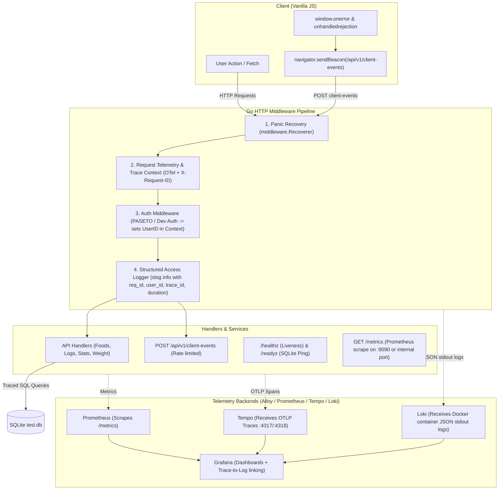

# Observability & Reporting Design: Calorize

**Date:** 2026-11-07  
**Status:** Approved  
**Scope:** `calorize-api` (Go backend), `static-web` (Vanilla JS frontend), and `docker/observability` stack.

---

## 1. Executive Summary

This specification outlines the end-to-end observability, error reporting, metrics, and tracing architecture for Calorize, mirroring the phased patterns successfully proven in `off-kolor-api`. 

Key deliverables:
1. **Logging & Request Context:** Enriched `log/slog` with `request_id` (UUIDv7/forwarded), `user_id`, and `trace_id`. Single structured access log entry per request.
2. **Error Fidelity:** Strict distinction between 4xx user/client errors (e.g. 404 Not Found) and true 5xx internal failures. Standardized error response format and helper.
3. **Probes:** `/healthz` for liveness and `/readyz` for active SQLite database connectivity.
4. **Metrics:** Prometheus scrape endpoint (`/metrics`) exposing HTTP RED metrics (Rate, Errors, Duration), database connection/query metrics, and background daemon execution counters.
5. **Distributed Tracing:** OpenTelemetry (OTel) instrumentation exporting OTLP traces to Alloy/Tempo, correlated directly with logs via `trace_id`.
6. **Client Telemetry:** Hardened `POST /api/v1/client-events` endpoint with dual-pool rate limiting and query-string sanitization; lightweight vanilla JS unhandled error and rejection listeners with `navigator.sendBeacon`.
7. **Build Version Tracking:** Git SHA injected into API binary and web assets at Docker build time, returned via `X-Calorize-Build` headers and monitored for version skew.
8. **Observability Infrastructure:** Pre-configured Docker Compose stack (`docker/observability/`) with Prometheus, Alloy, Tempo, Loki, and provisioned Grafana dashboards and alert rules.

---

## 2. Architecture & Data Flow

---

## 3. Server-Side Telemetry & Error Fidelity

### 3.1 Contextual Logging (`slog`)
- Implement a custom `slog.Handler` wrapper that extracts:
  - `request_id`: From HTTP request header `X-Request-Id` or generated as a UUIDv7.
  - `trace_id`: From the active OpenTelemetry span context.
  - `user_id`: From the authenticated context (`auth.UserIDContextKey`).
- Every call to `slog.InfoContext(ctx, ...)` or `slog.ErrorContext(ctx, ...)` automatically outputs these attributes into the JSON log stream.
- Re-order middleware in `cmd/api-server/main.go` so the Access Logger runs *after* authentication, ensuring the logged completion line includes the authenticated `user_id`.

### 3.2 Error Handling & Fidelity
- Define typed sentinel errors in `internal/db`:
  - `ErrNotFound`
  - `ErrConflict`
  - `ErrInvalidInput`
- Introduce `api.WriteError(w http.ResponseWriter, r *http.Request, err error)` helper:
  - Unwraps errors with `errors.Is`.
  - Maps `ErrNotFound` -> 404, `ErrInvalidInput` -> 400, `ErrConflict` -> 409, and unexpected errors -> 500.
  - For 5xx errors: logs `slog.ErrorContext(r.Context(), "internal server error", "error", err, "path", r.URL.Path)` and includes the `request_id` in the JSON response body.
  - For 4xx errors: logs `slog.DebugContext` or `WarnContext` without alerting.
  - Response schema: `{"error": "description", "code": "NOT_FOUND", "request_id": "uuid"}`.

### 3.3 Probes
- `GET /healthz`: Immediate 200 OK verifying the process is alive.
- `GET /readyz`: Executes `db.PingContext(ctx)` against SQLite and confirms migrations and writeability. Returns 503 if unreachable or locked.

### 3.4 Prometheus Metrics
Using `github.com/prometheus/client_golang`:
- **HTTP RED Metrics**:
  - `calorize_http_requests_total{method, route, status}`
  - `calorize_http_request_duration_seconds{method, route, status}` (Histogram)
  - `calorize_http_response_size_bytes{method, route}`
- **Database Metrics**:
  - `calorize_db_query_duration_seconds{operation}`
  - `calorize_db_errors_total{kind}`
  - `calorize_db_connections{state}`
- **Endpoint**: Served on a dedicated internal port (e.g. `:9090/metrics`) or a protected route.

### 3.5 OpenTelemetry Tracing
Using `go.opentelemetry.io/otel`:
- Configure standard OTLP gRPC/HTTP exporter pointing to Alloy (`OTEL_EXPORTER_OTLP_ENDPOINT`).
- Wrap the main HTTP handler with `otelhttp.NewHandler`.
- Add tracing spans around SQLite query executions and long-running operations.

---

## 4. Client Telemetry & Background Daemons

### 4.1 Client Error Capture (`POST /api/v1/client-events`)
- **Endpoint Specifications**:
  - Payload: `{ events: [ { kind, message, location, route, build, ts } ] }`
  - Bounded size: Max 16 KiB body, max 20 events per batch, message truncated to 500 chars.
  - URL sanitization: Regex strips `\?.*$` and `#.*$` from error messages and stack URLs to prevent secret/token leaks.
  - Dual-pool rate limiting:
    - Authenticated users: 30/min per user, 600/min global.
    - Anonymous: 10/min per IP, 300/min global.
    - Rate limit drops recorded in metric `calorize_client_events_dropped_total{reason="rate_limit"}`.
- **Frontend Integration (`static-web/js/telemetry.js`)**:
  - Hooks `window.addEventListener('error')` and `window.addEventListener('unhandledrejection')`.
  - Transmits via `navigator.sendBeacon` (falling back to `fetch` with `keepalive: true`).
  - In-memory deduplication of duplicate messages per session.

### 4.2 Git SHA & Version Skew Tracking
- **Build Integration**:
  - Docker build args: `ARG GIT_SHA=dev`.
  - Go compile flag: `-ldflags="-X 'main.GitSHA=${GIT_SHA}'"`.
  - Embed Git SHA into `docker/Dockerfile.web` (via `index.html` meta tag `<meta name="calorize-build" content="...">` or `/version.json`).
  - Calorize API emits `X-Calorize-Build: <GitSHA>` on all HTTP responses.
  - On startup, the server logs `GitSHA`.
- **Version Skew Detection**:
  - Client script periodically verifies `X-Calorize-Build` matches its own loaded version.
  - Emits `kind="version_skew"` event on mismatch and surfaces an unobtrusive reload notice.

### 4.3 Background Daemons Telemetry
- **Session Cleanup Daemon**:
  - Structured log `session_cleanup` with duration and removed count.
  - Metrics: `calorize_session_cleanup_duration_seconds`, `calorize_sessions_cleaned_total`, `calorize_session_cleanup_errors_total`.
- **AFCD Importer Daemon**:
  - Wrapped in background OTel trace span.
  - Structured log `importer_scan` with processed count, records imported, and duration.
  - Metrics: `calorize_importer_run_duration_seconds`, `calorize_importer_records_total`, `calorize_importer_errors_total`.

---

## 5. Observability Stack, Dashboards & Alerts

### 5.1 Infrastructure Layout (`docker/observability/`)
- `docker-compose.observability.yml`: Standalone or overlay compose file deploying:
  - **Prometheus**: Scrapes `calorize-api:9090`.
  - **Grafana Alloy**: Ingests OTLP traces on `:4317` and forwards to Tempo.
  - **Grafana Tempo**: Trace store.
  - **Grafana Loki**: Log ingestion parsing Docker JSON stdout logs.
  - **Grafana**: Pre-provisioned dashboards and data sources.

### 5.2 Provisioned Grafana Dashboard (`calorize-overview.json`)
- **API RED Metrics**: QPS, error rate (4xx/5xx), p50/p95/p99 latency.
- **Database**: Active connections, query durations, error counts.
- **Background Jobs**: Session cleanup count/duration, importer progress.
- **Client Errors**: JS errors and unhandled rejections grouped by route and message.
- **Loki Log Viewer**: Filterable log view with `trace_id` links directly to Tempo trace waterfall.

### 5.3 Alert Rules
- `CalorizeHighErrorRate`: 5xx error rate > 1% over 5m.
- `CalorizeHighLatency`: p95 latency > 1s over 5m.
- `CalorizeDatabaseUnhealthy`: `/readyz` probe failing.
- `CalorizeClientEventFlood`: Client event rate limiter saturated.
- `CalorizeClientErrorsMultipleUsers`: JS errors reported by $\ge 3$ distinct users within 10m.

---

## 6. Implementation Phasing

| Phase | Description | Deliverables |
|---|---|---|
| **Phase 0: Hygiene & Git SHA** | Docker build args with Git SHA, `/readyz` probe, JSON log rotation | `Dockerfile.api`, `Dockerfile.web`, `docker-compose.yml`, `readyz` endpoint |
| **Phase 1: Request Context & Error Fidelity** | `request_id`, `user_id` in `slog`, `WriteError` helper, 404/500 fixes | Middleware chain refactoring, error domain types, API error handler |
| **Phase 2: Prometheus Metrics & Daemons** | RED metrics, DB stats, session/importer counters | `prometheus/client_golang` integration, internal `:9090/metrics` |
| **Phase 3: OpenTelemetry Distributed Tracing** | OTel HTTP middleware, DB spans, `trace_id` in logs | `go.opentelemetry.io/otel` setup, OTLP exporter to Alloy/Tempo |
| **Phase 4: Client Error Telemetry** | `POST /api/v1/client-events`, vanilla JS tracker, URL sanitizer, rate limiter | `telemetry.js`, client event endpoint, dual rate limiter |
| **Phase 5: Observability Stack & Dashboards** | Docker compose monitoring stack, Alloy config, Grafana dashboard, alert rules | `docker/observability/*`, alert rules, dashboard JSON |

---

## 7. Spec Self-Review Check
- **Placeholders**: None. All components, metrics, endpoints, and data flows are explicitly specified.
- **Internal Consistency**: Docker build Git SHA, logging context, OTel tracing, and client beacons are mutually consistent.
- **Scope Check**: Phased roadmap allows independent, verifiable PR-sized iterations.
- **Ambiguity Check**: Error code mapping, rate limit rules, and sanitization boundaries are precisely defined.
